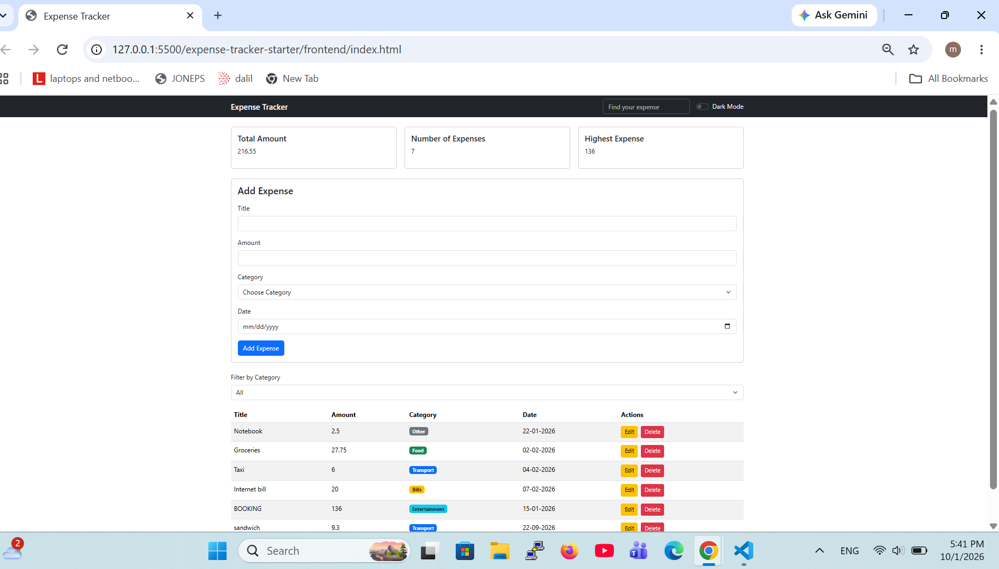
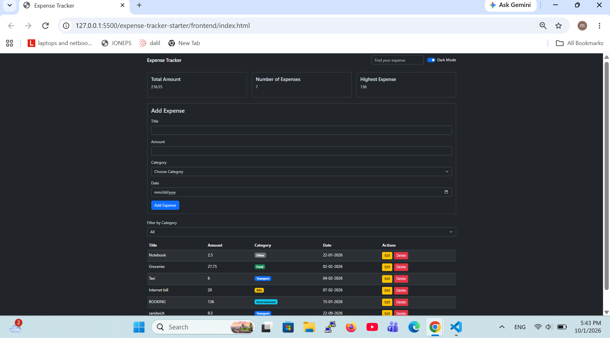
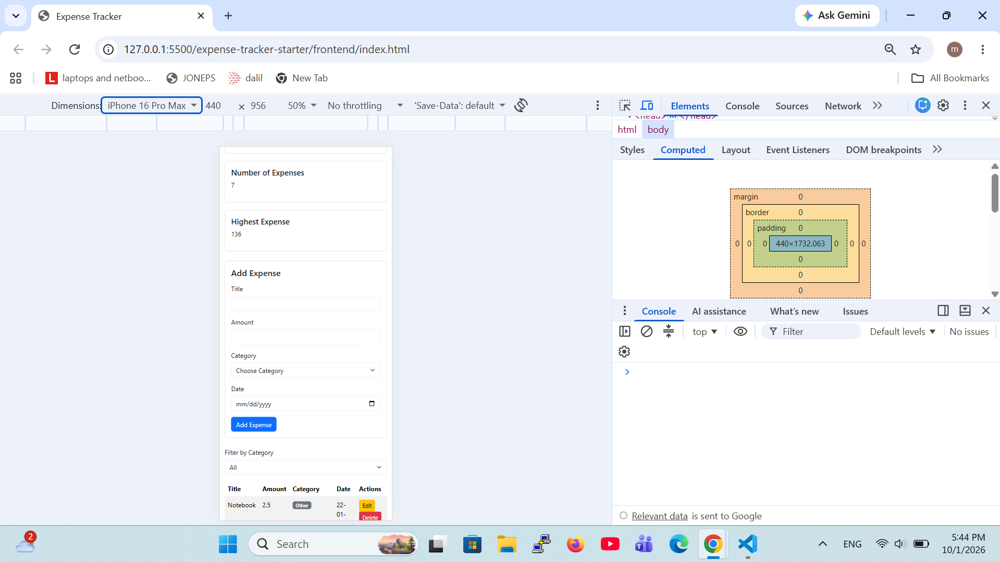

# Expense Tracker

Expense Tracker is a web application for managing daily expenses.
From it users can add, edit, delete, search and filter expenses,To help them managing their life and to see where there money goes.

## How to run

1. Extract the project ZIP file.
2. Open Visual Studio Code.
3. Open the project folder in Visual Studio Code.

**Backend**

1. Open the backend folder in the terminal.
2. Install the required packages:
   npm install
3. Create the PostgreSQL database and run the schema.sql file.
4. Create the .env file and add the database connection information.
5. Start the server:
   Write node server.js on the termial
6. Make sure the server is running on port 3000

**Frontend**

1. Open the frontend folder.
2. Open index.html using Live Server.
3. The Expense Tracker application is now ready to use.

## Features

- [x] Add an expense (with validation)
- [x] Delete an expense
- [x] Edit an expense
- [x] Filter by category
- [x] Summary cards (total, count, highest)
- [x] Data is saved in a PostgreSQL database

## Screenshots

## What was the hardest part?

The hardest part was connecting the frontend with the backend using fetch.
At first, it was difficult to understand how the data moves between the frontend and the server.
